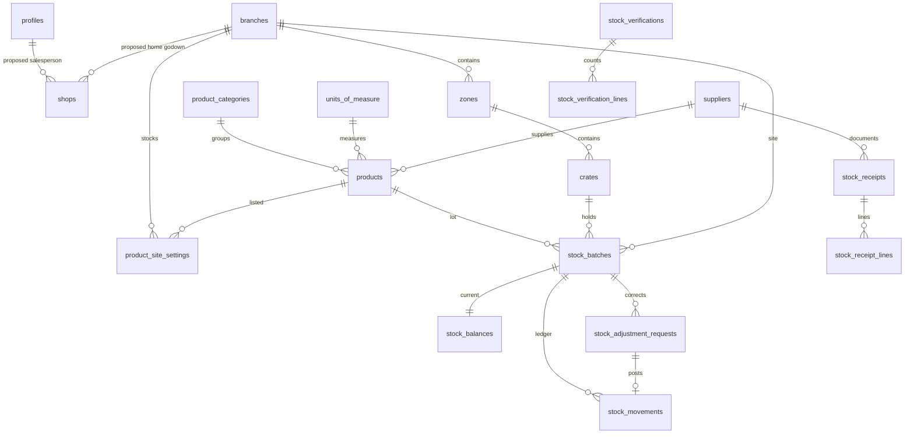
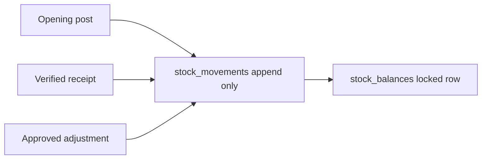

# Phase 2C — Master data and operational foundation

Phase 2C.1 is deployed to development project `ypkfondrkhkydkgovwup` as `20261014210000_master_data.sql`. Phase 2C.2 is deployed to the same project as `20261015120000_master_data_access.sql`. The master-data screens and the approved grants are on that project. Phase 2C is not complete, and Phase 2C.3 has not started. Sections 4 through 12 are the earlier planning proposal. Where they disagree with section 13, section 13 is the schema that was built. Section 14 is the access model and the screens that were deployed.

## 1. Executive summary

SherlysOS can sign people in, assign six roles, and record operating sites. Phase 2C.1 adds the product, supplier, shop, zone, and crate tables. Phase 2C.2 adds the approved management screens and grants. There is still no stock balance. The business-process blueprint requires the later ledger before Orders, Receiving, Daily Stock Verification, Damage, Deliveries, or Stock Refill can post anything truthful.

Phase 2C should add reference data first, then a stock ledger that only a database function can change. Balances stay derived from an append-only movement history. The existing `branches` table remains the godown. BPM “Branch 01” through “Branch 05” stay workflow names and are not new site rows.

Zones, crates, expiry-aware batches, and supplier documents are explicit in the blueprint. Separate category and unit catalogs, a numeric reorder threshold, and who may post opening stock are design proposals and need a business decision before they are treated as rules.

## 2. Existing architecture assessment

Reviewed:

- `reference/Sherlys_Distribution_Agents_BPM.pdf` (v1.0, five workflows, six personas)
- `supabase/migrations/20261014000000_foundation.sql`
- `supabase/migrations/20261014150000_access_control.sql`
- `supabase/migrations/20261014180000_profile_phone.sql`
- `supabase/migrations/20261014190000_profile_email.sql`
- `docs/access-control.md`
- `docs/database-migration-strategy.md`
- `docs/implementation-progress.md`
- `src/app/navigation.ts`, `src/app/router.tsx`
- `src/features/masters/MastersPage.tsx` and the administration features
- `src/lib/access/use-access.ts`, `src/lib/auth/RequireAuth.tsx`
- `supabase/functions/create-employee/index.ts`

### What exists

| Area | Current state |
| --- | --- |
| Auth | Supabase Auth. No public signup. New accounts use the `create-employee` Edge Function. |
| People | `profiles` (`full_name`, `employee_code`, `phone_number`, `email`, `is_active`), `user_roles`. |
| Sites | `branches` is an operating site, not a BPM workflow. `user_branch_assignments` scopes a person to a site. Admin has `branches.access_all`. |
| Permissions | Six roles and the catalog in section 6. `app_private.has_permission` returns false when the profile is inactive. |
| Audit | Append-only `audit_logs`, written by `app_private.write_audit`. |
| Configuration | `stock.adjustment.exceptional_absolute_units` is seeded as `50` and is explicitly not an approved rule. `stock.adjustment.exceptional_requires_admin` is `true`. |
| Routes | Placeholder pages for orders, deliveries, damage, receiving, verification, refill, inventory, and masters. Administration routes are permission-gated. Operational placeholders are not. |
| Stock | No product, shop, supplier, batch, balance, movement, receipt, verification, or adjustment table exists in the migrations. |

`docs/access-control.md` still says the access migration was not applied and that email stays only in Auth. The development database has since applied the access, phone, and email migrations. The permission matrix in that document matches the migration.

Reusable pieces for Phase 2C:

- Site scope through `branches`, `user_branch_assignments`, and `app_private.can_work_at_branch`.
- Privileged writes as `SECURITY DEFINER` functions with `search_path = ''`, permission checks, and audit rows. Clients do not get insert, update, or delete policies.
- UI patterns: `PageHeader`, `DataTable`, `AppModal`, `StatusBadge`, `EmptyState`, `LoadingBlock`, `RequirePermission`, and the Users & role search/filter/detail pattern.
- The stock-adjustment contract already written in `docs/access-control.md`: locked balance row, append-only movement, idempotency key, exceptional approval, audit.

There is no TypeScript domain model for products, shops, or stock. Screens talk to Supabase through the browser client and RPCs.

## 3. BPM-derived requirements

The PDF title is “Sherlys Distribution & Agents OS — Business Process and Automation Blueprint v1.0”. It documents five workflows and six personas. It does not include a data dictionary.

### A. Explicit in the BPM

| Topic | What the blueprint states |
| --- | --- |
| Shops | Orders come from shops. A Salesperson sells to shops and develops new shops. Accounts verifies the shop request. |
| Products | Orders are for products. Refill requests name FMCG brand-specific quantities and SKUs. |
| Suppliers | Goods arrive from an FMCG company. Receiving compares a supplier document with counted cases. An approved refill is sent to the FMCG supplier, which then dispatches. |
| Godown, zone, crate | Accepted stock is allocated to Godown, Zone, and Crate. Daily verification selects that same scope. |
| Cases | Receiving and verification count cases. Damaged cases stay out of available inventory. |
| Expiry and receipt order | Picking uses expiry and first-in receipt sequence (FEFO/FIFO). |
| Stock balance | Verification compares a physical count with the system balance. Posted stock is never overwritten. A correction is an authorized adjustment with an audit record. |
| Receiving | Arrival, document check, count, damage or quantity variance, allocation, Godown Manager verification, then posting. An unverified receipt does not increase available stock. |
| Verification | Scope, physical count, mismatch, report, snapshot and photo, recount and supervisor review, then a controlled correction only when approved. |
| Refill | A low-stock threshold or extra demand starts a request. Accounts prepares it. Admin approves, holds, or rejects it. Approval is not a receipt. Branch 03 (receiving) posts accepted stock later. |
| Damage | Six situations: refill supply, unloading, storage, loading, transit, and in-shop or expired returns. Damaged or returned goods stay unavailable until disposition. |
| Delivery | Godown Manager assigns a vehicle and a Delivery Person. The Delivery Person delivers to the shop. |
| Personas | Admin, Accounts, Godown Manager, Salesperson, Delivery Person, Store Keeper. Responsibilities match the role descriptions already stored on `roles`. |

### B. Already implied by this application

- Operating sites live in `branches`. A person works at a site only through `user_branch_assignments`, unless they have `branches.access_all`.
- The permission catalog already names order capture and verification, delivery notes, invoices, picking, delivery assignment and execution, receiving execution and verification, damage recording, refill request and approval, shop development, and the stock verification and adjustment split.
- Godown Manager owns verification and posts routine adjustments. Store Keeper may assist counts and does not own verification. Admin approves exceptional adjustments. Those grants are already in `role_permissions`.
- Inactive profiles fail `has_permission`. The app also blocks the workspace after sign-in.
- Stock mutations, when built, go through PostgreSQL functions. The adjustment function contract is already specified. Phase 2C should follow it instead of inventing a second posting path.
- `audit_logs` is the security history. Stock movements are a separate business ledger. Both are required: the ledger explains the quantity, and the audit log explains who was allowed to post it.

### C. Proposed, and not a confirmed business rule

| Proposal | Why it is not treated as confirmed |
| --- | --- |
| A category catalog | The BPM names products, brands, and SKUs. It does not define categories. |
| A unit catalog beyond the case | Counts in the BPM are cases. Other units are not specified. |
| Several suppliers for one SKU | Refill is brand-specific to an FMCG company. One supplier per product is the smaller reading. Many-to-many is unstated. |
| Several salespeople on one shop | The Salesperson develops shops. The PDF does not say whether a shop has one current salesperson or several. |
| A numeric reorder point | “Low-stock threshold” is named. No quantity is given. The seeded adjustment value `50` must not be reused as this threshold. |
| Who may post opening stock | The BPM assumes a system balance. It does not describe an opening-stock ceremony. |
| Vehicle master fields | A vehicle is assigned. No vehicle attributes are listed. Leave the vehicle register for the delivery phase unless the business wants it in 2C. |
| Shop address fields | A shop is identified. Street, city, and map coordinates are not specified. |
| Fractional quantities | The described counts are cases. Decimal quantities are not specified. |

## 4. Proposed database schema

New tables use `uuid` primary keys, `timestamptz` audit columns, and soft deactivation with `is_active`. Clients may select rows only through RLS. Inserts and updates go through RPCs. No client policy grants write access.

`created_at` and `updated_at` use the existing `app_private.set_updated_at` trigger where a row can change. Ledger and request-event rows are append-only and have `occurred_at` instead of an editable `updated_at`.

### 4.1 Reference masters

#### `product_categories` — proposed

Purpose: optional grouping for the product screen. Not named in the BPM.

| Column | Type | Notes |
| --- | --- | --- |
| id | uuid | Primary key. |
| code | text | Unique. Lowercase shape `^[a-z0-9_]+$`, same style as `branches.code`. |
| name | text | Unique, trimmed, 1–80 characters. |
| is_active | boolean | Default true. |
| created_at, updated_at | timestamptz | |

Foreign keys: none. Index: `is_active`. Deactivating a category does not delete products; products keep the historical category id.

#### `units_of_measure` — proposed, with one BPM-backed unit

Purpose: the unit stored on a product. The BPM count unit is the case.

| Column | Type | Notes |
| --- | --- | --- |
| id | uuid | Primary key. |
| code | text | Unique. Proposed first code: `case`. |
| name | text | Unique. Proposed label: Case. |
| is_active | boolean | |
| created_at, updated_at | timestamptz | |

Do not seed extra units. Do not seed products.

#### `suppliers`

Purpose: the FMCG company on a refill and on a receiving document.

| Column | Type | Notes |
| --- | --- | --- |
| id | uuid | Primary key. |
| code | text | Unique. |
| name | text | Required, 1–160 characters. |
| contact_name | text | Nullable. Proposed. |
| phone | text | Nullable. Same shape as `profiles.phone_number` if provided. |
| email | text | Nullable. |
| is_active | boolean | |
| created_at, updated_at | timestamptz | |

BPM evidence is the supplier document and the company that dispatches. Contact columns are the practical minimum and should be confirmed.

#### `products`

Purpose: the SKU that can be ordered, received, picked, counted, and refilled.

| Column | Type | Notes |
| --- | --- | --- |
| id | uuid | Primary key. |
| sku | text | Unique, trimmed, 1–40 characters. This is the BPM SKU. |
| name | text | Required, 1–160 characters. |
| brand_name | text | Required. Refill is brand-specific. |
| category_id | uuid | Nullable FK to `product_categories`. Null until categories are approved. |
| unit_id | uuid | FK to `units_of_measure`. Not null once units exist. |
| supplier_id | uuid | Nullable FK to `suppliers`. One supplier per product unless a later decision adds a junction table. |
| is_active | boolean | Inactive products cannot be newly ordered, received, or refilled. History remains. |
| created_at, updated_at | timestamptz | |

Indexes: unique `sku`, `supplier_id`, `is_active`, `brand_name`. No selling price, tax, or barcode: the BPM does not define them.

#### `shops`

Purpose: the customer outlet that places an order and receives a delivery.

| Column | Type | Notes |
| --- | --- | --- |
| id | uuid | Primary key. |
| code | text | Unique shop code. |
| name | text | Required, 1–160 characters. |
| contact_name | text | Nullable. Proposed. |
| phone | text | Nullable. Proposed. |
| address_line | text | Nullable. Proposed. The BPM does not specify an address format. |
| salesperson_id | uuid | Nullable FK to `profiles`. Proposed single current salesperson. |
| branch_id | uuid | Nullable FK to `branches`. Proposed home godown for that shop. The BPM does not say every shop belongs to one godown. |
| is_active | boolean | |
| created_at, updated_at | timestamptz | |

Index: `salesperson_id`, `branch_id`, `is_active`. Reassignment is an update plus an audit row, not a silent overwrite without history.

#### `zones`

Purpose: the zone inside one operating site. Explicit in receiving and verification.

| Column | Type | Notes |
| --- | --- | --- |
| id | uuid | Primary key. |
| branch_id | uuid | FK to `branches`. Restrict on delete. |
| code | text | Unique together with `branch_id`. |
| name | text | |
| is_active | boolean | |
| created_at, updated_at | timestamptz | |

#### `crates`

Purpose: the crate inside a zone. Explicit in allocation and verification scope.

| Column | Type | Notes |
| --- | --- | --- |
| id | uuid | Primary key. |
| zone_id | uuid | FK to `zones`. Restrict on delete. |
| code | text | Unique together with `zone_id`. |
| name | text | |
| is_active | boolean | |
| created_at, updated_at | timestamptz | |

#### `product_site_settings`

Purpose: whether a product is handled at a godown, and the unapproved place to store a future reorder threshold.

| Column | Type | Notes |
| --- | --- | --- |
| id | uuid | Primary key. |
| branch_id | uuid | FK to `branches`. |
| product_id | uuid | FK to `products`. |
| is_stocked | boolean | Default true. |
| reorder_level | numeric(14,3) | Nullable. No default number. |
| created_at, updated_at | timestamptz | |

Unique `(branch_id, product_id)`. A missing row means the product is not set up at that site. This table does not store a quantity on hand.

### 4.2 Stock foundation

These tables are designed for 2C.6 and for later operational modules. Phase 2C posts only opening movements. Receiving, picks, deliveries, damage, and refill movements use the same ledger later.

#### `stock_batches`

Purpose: one receivable lot at one crate, so picking can honor expiry and receipt order.

| Column | Type | Notes |
| --- | --- | --- |
| id | uuid | Primary key. |
| product_id | uuid | FK to `products`. |
| branch_id | uuid | FK to `branches`. Denormalized from the crate’s zone so site checks do not walk three joins inside the posting function. |
| crate_id | uuid | FK to `crates`. |
| supplier_id | uuid | Nullable FK. Set when the lot came from a supplier document. |
| lot_code | text | Nullable human lot or batch code from the supplier document. |
| expiry_date | date | Nullable only if the business later allows undated goods. Picking cannot apply FEFO without it. |
| received_on | date | Receipt date used for FIFO. |
| is_available | boolean | False for quarantined damage. |
| created_at | timestamptz | Lots are not edited to change quantity. |

Unique proposal: `(product_id, crate_id, lot_code, expiry_date, received_on)` where `lot_code` is not null. Exact supplier lot identity needs confirmation.

#### `stock_balances`

Purpose: the current quantity of one batch. One row per batch.

| Column | Type | Notes |
| --- | --- | --- |
| batch_id | uuid | Primary key and FK to `stock_batches`. |
| quantity | numeric(14,3) | Non-negative. Changed only inside the posting function, under `SELECT … FOR UPDATE`. |
| updated_at | timestamptz | |

There is no client update grant. A zero balance remains so history still resolves.

#### `stock_movements`

Purpose: append-only ledger. Prior rows are not updated or deleted.

| Column | Type | Notes |
| --- | --- | --- |
| id | uuid | Primary key. |
| batch_id | uuid | FK to `stock_batches`. |
| movement_type | text | Check constraint. Phase 2C uses `opening` only. Later values: `receipt`, `adjustment`, and the operational types added with their modules. |
| quantity_delta | numeric(14,3) | Signed. Opening and receipt deltas are positive. |
| quantity_after | numeric(14,3) | Balance after this movement. |
| reason | text | Required, trimmed. |
| reference_table | text | Nullable until the source document exists. |
| reference_id | uuid | Nullable. |
| idempotency_key | text | Unique. Rejects a repeated submit. |
| actor_id | uuid | Copied profile id. No foreign key, matching `audit_logs`, so a deleted profile cannot rewrite history. |
| occurred_at | timestamptz | |

Indexes: `batch_id`, `occurred_at desc`, `idempotency_key`, `(reference_table, reference_id)`.

The posting function, in one transaction:

1. Requires an active caller and the permission for that movement type.
2. Requires `can_work_at_branch` unless the caller has `branches.access_all`.
3. Locks the balance row.
4. Inserts the movement with the resulting quantity.
5. Updates that balance row to the same quantity.
6. Writes `audit_logs`.
7. Rejects a negative result.

#### `stock_receipts` and `stock_receipt_lines`

Purpose: the supplier receiving document. Designed now so posting later has a reference. The receiving screens are a later operational phase, not 2C.2–2C.5.

Header: `id`, `branch_id`, `supplier_id`, `document_ref` (supplier document number), `status` (`draft`, `verified`, `posted`, `held`), `received_on`, `verified_by`, `verified_at`, `posted_at`, timestamps.

Lines: `id`, `receipt_id`, `product_id`, `crate_id`, `lot_code`, `expiry_date`, `cases_received`, `cases_damaged`, `cases_accepted`. Accepted cases are what may post. Damaged cases never increase `stock_balances`.

Unique `(branch_id, supplier_id, document_ref)` so the same supplier document is not posted twice.

#### `stock_verifications`, `stock_verification_lines`, `stock_count_evidence`

Purpose: DSV-01 through DSV-06. A snapshot does not change stock.

Header: `id`, `branch_id`, `status` (`open`, `recount`, `closed`), `started_by`, `started_at`, `closed_at`.

Lines: `id`, `verification_id`, `batch_id`, `system_quantity` copied at count time, `physical_quantity`, `counted_by`, `recount_quantity` nullable, `reviewed_by` nullable.

Evidence: `id`, `verification_id`, `storage_path` nullable, `note`. Photo storage policies are a later phase. The column reserves the DSV-05 photo without implementing Storage.

#### `stock_adjustment_requests`

Purpose: the controlled correction. Posting is a `stock_movements` row of type `adjustment`, not an edit of the balance by hand.

| Column | Type | Notes |
| --- | --- | --- |
| id | uuid | Primary key. |
| batch_id | uuid | FK. |
| verification_line_id | uuid | Nullable FK. The usual reference from a mismatch. |
| quantity_delta | numeric(14,3) | Requested change. |
| reason | text | Required. |
| status | text | `requested`, `approved`, `rejected`, `posted`. |
| exceptional | boolean | Set by the posting function from the configuration rules, not by the client. |
| approved_by | uuid | Required before post when `exceptional` is true. |
| posted_movement_id | uuid | Nullable FK to `stock_movements`. |
| idempotency_key | text | Unique. |
| requested_by | uuid | |
| created_at | timestamptz | |

The existing rule stands. Godown Manager may request and post a routine adjustment. If exceptional approval is required and the absolute delta exceeds the configured units, Admin must approve first. The configured unit value remains the unapproved placeholder `50` until the business replaces it. Do not copy `50` into reorder levels.

### 4.3 Audit

Every RPC that creates or deactivates a master row calls `app_private.write_audit`. Stock posting writes both the movement and an audit row. Master-data edits store the changed field names in `audit_logs.metadata`, not the whole before-image of unrelated columns.

Deactivation sets `is_active = false`. It does not delete the row. Posted movements are never deleted.

### 4.4 Relationship to existing tables

- `zones.branch_id` → `branches.id`
- `shops.salesperson_id` and movement `actor_id` refer to `profiles`
- `shops.branch_id` and stock site columns → `branches.id`
- No new role rows. New permission rows would be inserted only after the matrix in section 6 is approved.
- `app_configuration` keeps the two existing stock keys. A reorder key is not added until a threshold is approved.

## 5. Entity relationship diagram



## 6. Proposed role and permission matrix

Existing grants stay as they are. Nothing in this plan removes or reassigns a current permission.

New permissions, all awaiting approval before they are inserted:

| Permission | Purpose | Proposed holders |
| --- | --- | --- |
| `products.read` | View products, categories, and units. | Admin, Accounts, Godown Manager, Store Keeper, Salesperson |
| `products.manage` | Create and deactivate products, categories, and units. | Admin |
| `suppliers.read` | View suppliers. | Admin, Accounts, Godown Manager, Store Keeper |
| `suppliers.manage` | Create and deactivate suppliers. | Admin |
| `shops.read` | View shops. | Admin, Accounts, Salesperson, Godown Manager, Delivery Person |
| `shops.manage` | Create and deactivate any shop, and change salesperson or site. | Admin |
| `locations.read` | View zones and crates. | Admin, Godown Manager, Store Keeper, Accounts |
| `locations.manage` | Create and deactivate zones and crates. | Admin. Godown Manager only for an assigned site, if approved. |
| `stock.read` | View balances and movements. | Admin, Accounts, Godown Manager, Store Keeper |
| `stock.opening.post` | Post an opening movement through the ledger function. | Admin |

`shops.develop` already belongs to Salesperson. This plan does not widen it. A possible later reading is that Salesperson may create a shop and set themselves as its salesperson. That reading needs an explicit yes before the RPC allows it.

Delivery Person is not given master-data management. They need the shop name and address at delivery time, which is why `shops.read` is proposed for them. Transit damage remains unresolved and is not granted here.

Read and write by master:

| Record | Read | Create or edit | Deactivate |
| --- | --- | --- | --- |
| Category, unit, product | `products.read` | `products.manage` | `products.manage` |
| Supplier | `suppliers.read` | `suppliers.manage` | `suppliers.manage` |
| Shop | `shops.read`, further limited to own shops for Salesperson if the business chooses that | `shops.manage` | `shops.manage` |
| Zone, crate | `locations.read` and site scope | `locations.manage` and site scope | same |
| Product-at-site row | `products.read` or `stock.read`, plus site scope | `products.manage` | `products.manage` |
| Opening movement | `stock.read` | `stock.opening.post` | Cannot be deactivated. A correcting movement is a later adjustment. |
| Balance | `stock.read` and site scope | Nobody by table update | Not applicable |

RLS shape, matching Phase 2A:

- Enable and force RLS on every new table in the migration that creates it.
- `authenticated` receives select policies only.
- Site-bound rows require `branches.access_all` or `can_work_at_branch`.
- `anon` receives nothing.
- `service_role` table writes stay revoked where the same revoke pattern already protects access tables. Posting uses a definer function owned by the migration role.
- Salesperson shop visibility, if limited to `salesperson_id = auth.uid()`, must be a written rule. It is not assumed below as already decided. Until that decision, `shops.read` means all shops, which may be wider than the business wants.

## 7. Frontend screen specifications

Build these only after 2C.1 is approved and applied. Keep the current shell, Plus Jakarta Sans, navy sidebar, white cards, and `ring-1` borders. Replace the single `/masters` placeholder with a masters index and the routes below. Do not invent sample rows. Empty states say that records appear after someone creates them.

Shared behavior:

- Header with title, one-line description, and a primary button only when the caller has the manage permission.
- Search box and an active/inactive filter.
- Table on desktop. On a narrow screen, the same rows become stacked cards rather than a second design.
- Create and edit use `AppModal`. Deactivate asks for confirmation, as Employees already does.
- Required fields block submit. Server errors from the RPC use the existing toast.
- Loading uses `LoadingBlock`. A failed query uses `EmptyState` with the database message.
- Direct visits without the read permission use the existing access-denied page.

### Product management — `/masters/products`

Columns: SKU, name, brand, category, unit, supplier, status. Search name, SKU, and brand. Filter by category, supplier, and status.

Form fields: SKU, name, brand (required); category, unit, supplier, active (unit required once the unit master exists). SKU unique. Inactive supplier or unit cannot be selected.

Actions: create, edit, deactivate for `products.manage`. Others with `products.read` can open a details dialog only.

### Category management — `/masters/categories`

Columns: code, name, status. Search code and name. Form: code, name, active. Both required and unique. Hide this screen if categories are not approved; products then omit the category field.

### Unit management — `/masters/units`

Columns: code, name, status. Form: code, name, active. The expected first row is Case, entered by an administrator, not seeded as a hidden rule. Block deactivation when an active product still uses the unit.

### Customer / shop management — `/masters/shops`

Columns: code, name, phone, salesperson, site, status. Search code, name, and phone. Filter by salesperson, site, and status.

Form: code, name (required); contact name, phone, address, salesperson, home godown, active (optional until the business makes them required). Salesperson list contains active profiles that hold the Salesperson role. Site list contains active `branches` the caller may use.

### Supplier management — `/masters/suppliers`

Columns: code, name, phone, email, status. Form: code, name (required); contact name, phone, email (optional). Email must contain `@` when present. Phone uses the same length check as profiles.

### Godown product mapping — `/masters/sites`

Two levels on one page, because the BPM location is Godown, then Zone, then Crate.

- Site list reuses `branches`. This screen does not rename a site. Rename remains an open Phase 2B gap.
- Selecting a site shows zones and crates, and a product checklist from `product_site_settings`.
- Zone and crate forms: code, name, active. Product mapping: stocked flag, and a blank reorder level. The reorder field stays disabled until a threshold rule is approved.
- Godown Manager actions, if granted, are limited to assigned sites.

### Opening stock preparation — `/masters/opening-stock`

This is not a grid of editable balances.

Columns of posted openings: date, site, zone, crate, SKU, lot, expiry, quantity, actor. Filter by site and product.

Form: site, zone, crate, product, lot code, expiry date, received-on date, quantity, reason. All required for a new opening. Quantity is a positive case count unless fractional units are later approved. Submit calls the posting RPC once. A second click with the same idempotency key does not double the balance. The balance itself is shown from `stock_balances` and is read-only.

## 8. Stock ledger architecture



Available quantity for a product at a site is the sum of `stock_balances.quantity` for available batches at that site. Quarantined batches stay out of that sum. Verification copies the sum onto the count line at the moment of the count so a later movement does not rewrite the snapshot.

Phase 2C implements the opening arrow only. Receipt posting waits for the receiving module. Adjustment posting waits until verification can create a request, and it must use the contract already in `docs/access-control.md`. Picks, deliveries, damage, and refill are later movement types on this same ledger. They are not extra balance columns.

## 9. Implementation stages

Each stage is a later implementation task. This planning task does not start them.

### 2C.1 — Master data schema and RLS

- Depends on approval of sections 4 and 6, especially categories, units, shop ownership, and the new permissions.
- Database: the reference tables and their select policies. No stock tables yet.
- Backend: RPCs to create, update, and deactivate each master. No Edge Function unless a later integration needs a secret.
- Frontend: none, or only a permission-aware empty masters index if a route flag is needed for testing.
- Tests: migration applies on a disposable database; a caller without the permission is rejected; self-service cannot be used to widen a role; audit rows are written.
- Acceptance: tables exist, clients cannot write them directly, and no sample products are inserted.

### 2C.2 — Product, category, and unit management

- Depends on 2C.1.
- Frontend: the three screens in section 7.
- Tests: unique SKU, inactive unit rejected, empty states, permission hiding, browser pass on desktop and a narrow viewport.
- Acceptance: an administrator can maintain the catalog, and a Salesperson can read it only if `products.read` was granted.

### 2C.3 — Customer / shop management

- Depends on 2C.1 and on profiles so a salesperson can be chosen.
- Frontend: shop screen.
- Acceptance: a shop can be created, assigned, deactivated, and found by search. No order can be placed yet.

### 2C.4 — Supplier management

- Depends on 2C.1.
- Frontend: supplier screen. Products can then store `supplier_id`.
- Acceptance: a supplier can be deactivated without deleting historical product links.

### 2C.5 — Godown product mapping

- Depends on 2C.2, sites, and the zone/crate decision.
- Frontend: site mapping screen.
- Acceptance: a product can be marked stocked at a site, and a Godown Manager cannot change another site unless they have `branches.access_all`.

### 2C.6 — Stock ledger and opening stock

- Depends on 2C.5, because an opening needs a product, a crate, and a site.
- Database: batch, balance, movement, plus the receipt, verification, and adjustment tables if they are created empty of workflows.
- Backend: one opening-stock function. It is the template for later receipt and adjustment functions.
- Frontend: opening-stock screen.
- Tests: repeated submit does not double quantity; a negative result is rejected; a Salesperson cannot post; the balance matches the movement; an inactive caller is rejected.
- Acceptance: opening quantity is visible and not editable, and no other movement type posts yet.

Before any Phase 3 operational module, 2C.1 through 2C.6 need to be in place for the data that module reads. Orders need shops and products and a readable balance. Receiving needs suppliers, locations, and the ledger function. Verification needs batches and balances. Refill needs products, suppliers, and a threshold decision. Damage and delivery can wait for their own movement types, but they still need the same ledger.

## 10. Security and testing strategy

- Keep the six roles. Add permissions only by a reviewed migration.
- RPCs check `auth.uid()`, an active profile, and the specific permission. Site-bound writes also check `can_work_at_branch`.
- Duplicate the same checks in the UI so buttons hide, and treat the database as the boundary.
- Do not put the service-role key in the frontend. Master data does not need an Edge Function.
- Do not grant `authenticated` update on `stock_balances` or `stock_movements`.
- Tests for each stage: SQL permission failures, Vitest for navigation gating, and a browser pass with the Admin and one non-admin disposable user. Remove disposable users afterward. Do not delete the real Admin.
- Run typecheck, oxlint, Vitest, and a production build before any Phase 2C commit.

## 11. Dependencies and risks

| Risk | Effect |
| --- | --- |
| Category, unit, or shop-ownership decision slips | 2C.1 should not guess. Products can ship with a nullable category, and shops can ship with a nullable salesperson, but the screens should not pretend the rule is settled. |
| Reorder threshold copied from the placeholder `50` | Would invent a refill rule. Leave `reorder_level` null. |
| Opening stock posted by editing a balance | Breaks the audit trail the BPM requires. Only the movement function may change quantity. |
| Zones and crates skipped | Receiving and verification scope from the BPM cannot be stored. |
| Expiry left optional without a decision | FEFO picking cannot be honest. |
| `docs/access-control.md` left stale | Reviewers may think email and the applied migrations are still pending. Updating that document is documentation hygiene, not part of the schema work. |
| Operational routes stay open to every signed-in user | Already true. Phase 2C screens must still be permission-gated. Fixing the older placeholders is a separate decision. |

## 12. Business decisions required before implementation

1. Approve or reject product categories as a master.
2. Confirm that Case is the unit for stock, and whether any other unit exists.
3. Confirm one supplier per SKU, or a many-to-many supply relationship.
4. Confirm one current salesperson per shop, or many.
5. Confirm whether a shop has one home godown.
6. Confirm that Godown, Zone, and Crate are the location levels under `branches`.
7. Confirm who may post opening stock. This plan proposes Admin only.
8. Approve the new permission rows and the proposed holders in section 6. In particular, whether a Salesperson may create shops under the existing `shops.develop` permission, and whether a Godown Manager may maintain zones and crates.
9. Provide the real low-stock threshold, or confirm that refill stays manual until one exists. Do not adopt `50`.
10. Confirm whether quantities are whole cases.
11. Leave the exceptional adjustment threshold and Delivery Person transit damage (DMG-05) unresolved. They are not Phase 2C masters.

## Recommended first implementation stage

Start with **2C.1 — Master data schema and RLS**, after the decisions in section 12 that affect columns and grants. Do not start with screens, and do not open the stock ledger until products and locations exist.

The Phase 2C.1 tables in section 13 exist locally and on development project `ypkfondrkhkydkgovwup`. Phase 2C.2 implementation is complete. Its screens and grants are recorded in section 14 and are deployed on that project as `20261015120000_master_data_access.sql`.

## 13. Phase 2C.1 local implementation

Migration: `supabase/migrations/20261014210000_master_data.sql`.

Repeatable local checks: `supabase/tests/phase_2c1_master_data.sql`. The script rolls back. After it ran, the local database had the empty tables, no auth users, and no sample products, zones, or crates.

### 13.1 Confirmed storage hierarchy

```text
branches (existing godown / operating site)
  -> zones
      -> crates
          -> future stock quantities, in whole carton cases
```

A product is a master row. A carton case is the only inventory unit. A crate is the physical location. Those three are not the same row. No row is created per physical carton.

`branches` is reused. BPM workflow branches are not godowns. No zones or crates were seeded.

### 13.2 Tables

| Table | Purpose | Writes |
| --- | --- | --- |
| `product_categories` | Optional grouping. Name unique on `lower(name)`. No hierarchy. | `products.manage` |
| `suppliers` | One supplier company. Optional phone and email. | `suppliers.manage` |
| `products` | SKU and name. Nullable `supplier_id` and `category_id`. No quantity. | `products.manage` |
| `shops` | Customer shop. Optional phone and address. No godown column. | `shops.manage` |
| `shop_salesperson_assignments` | Many salespersons per shop. Active pair is unique. History is kept. | `shops.manage` |
| `zones` | Area inside one godown. Code unique per godown, case-insensitive. | `locations.manage` plus `can_work_at_branch` |
| `crates` | Location inside one zone. Code unique per zone, case-insensitive. Godown is `zones.branch_id`. | `locations.manage` plus the parent godown check |

Primary keys are `uuid`. Foreign keys use `ON DELETE RESTRICT`. There is no delete function. Deactivation sets `is_active`. `assigned_by` and `revoked_by` copy the actor id and do not reference `profiles`, matching `user_roles.assigned_by`.

Names are trimmed and 1–160 characters. Codes and SKUs are trimmed and 1–40 characters. Phone, when present, is 7–24 characters. Email, when present, is stored lowercase. Category names and SKUs are unique case-insensitively. Supplier names are not unique, because that was not required.

Not created, on purpose:

- `units_of_measure`. The approved unit is the carton case, so there is nothing to convert.
- `product_crate_assignments`. Capacity, one-product crates, and permanent SKU placement are unresolved. A junction table would also be the wrong place for a quantity.
- `product_site_settings` and any reorder column. The provisional value 50 is not a reorder level.
- Stock batches, balances, movements, receipts, verifications, and adjustments.

### 13.3 Row-level security and permissions

RLS is enabled and forced on all seven tables. `authenticated` can select only. There is no insert, update, or delete policy. `anon` has no table privileges. `service_role` cannot insert, update, delete, or truncate these tables.

Select policies:

- Categories and products require `products.read`.
- Suppliers require `suppliers.read`.
- Shops and assignments require `shops.read`.
- Zones require `locations.read` and `can_work_at_branch(branch_id)`.
- Crates require `locations.read` and the same check through the parent zone.

`has_permission` still requires an active profile.

Catalog permissions added: `products.read`, `products.manage`, `suppliers.read`, `suppliers.manage`, `shops.read`, `shops.manage`, `locations.read`, `locations.manage`, `stock.read`, `stock.opening.post`.

The only new grant is Admin → `stock.opening.post`. No other role received a new permission. There is no opening-stock function, so the grant does not post anything.

Mutations go through security-definer functions with `search_path = ''`. They check the manage permission, then validate. Zone and crate functions also require an active godown and `can_work_at_branch`. A zone cannot be moved to another godown. A crate cannot be moved to another zone. A new crate requires an active zone. A crate cannot be reactivated while its zone is inactive.

Shop assignment requires an active shop and an active profile that holds the Salesperson role. A duplicate active pair is rejected. Revocation keeps the row. If the Salesperson role is removed, or the profile becomes inactive, current assignments are deactivated and are not restored when the role or profile returns. Cross-godown assignment is not checked, because a shop has no godown. Whether assignment needs its own permission is still open; until then the functions require `shops.manage`, which nobody has.

### 13.4 Future crate-level ledger

Not implemented. Later stock tables should be able to represent:

- Opening stock posted by Admin into one product and one crate, as a whole number of cases.
- Receipt into a crate.
- Movement between crates, including a move whose crates are in different zones or godowns.
- Dispatch out of a crate.
- A verification snapshot and discrepancy at crate level.
- A controlled adjustment. Routine posting stays with the Godown Manager. Exceptional approval stays with Admin. The value 50 remains provisional.
- A refill approval that does not itself increase stock.

The ledger should be append-only. Balance changes belong in the same transaction as the movement. Ordinary users do not update balances. Source and destination crates identify a transfer. The godown and zone are derived from the crate. Negative stock is rejected. Store Keeper count assistance and Godown Manager verification ownership stay as already granted. Expiry, batch, and serial tracking are not decided, so they are not columns yet.

### 13.5 Local validation

| Check | Result |
| --- | --- |
| `npx supabase db reset --local` | Passed after correcting `position()` inside an empty `search_path`. All five migrations applied. |
| `npx supabase db lint --local` | Passed. No schema errors. |
| `npx supabase db advisors --local` | Passed. No issues. |
| `supabase/tests/phase_2c1_master_data.sql` | Passed, then rolled back. |
| `npm run typecheck` | Passed. |
| `npm run lint` | Passed. The project linter is oxlint. |
| `npm test` | Passed. 6 files, 13 tests. |
| `npm run build` | Passed. JS chunk about 932 kB. No application code changed. |

The SQL script checked foreign keys, case-insensitive SKU, zone, and crate uniqueness, reuse of the same zone or crate code in a different parent, missing parents, inactive-user denial, direct writes by `authenticated` and `service_role`, hidden rows without a read permission, godown isolation for zones and crates, salesperson eligibility, duplicate active assignments, assignment history, role-removal revocation, the existing role and branch functions, supplier delete protection, and Admin-only `stock.opening.post`. Temporary permission rows used to exercise those rules were deleted inside the same transaction and then rolled back.

Development project `ypkfondrkhkydkgovwup` received `20261014210000_master_data.sql` on 2026-10-15. Before that push, platform point-in-time recovery was off and the physical backup list was empty. A logical dump of the `public` and `auth` schemas and data was written outside the repository. After deployment, real Admin, Salesperson, inactive-user, and godown-isolation JWTs were checked. Disposable rows and the temporary permissions used for those checks were removed. The original administrator and `godown_main` remain. Phase 2C.2 was deployed afterward and is recorded in section 14.

### 13.6 Decisions still pending

These were not treated as approved:

1. Whether a product must have a category. The column is nullable.
2. Whether a product must have a supplier at creation. The column is nullable. One supplier per product is the shape already built.
3. Whether phone and email are the final supplier contact fields. No tax, bank, or credit columns were added.
4. Whether a shop needs a code or a structured address. The row has a name, an optional phone, and an optional address line.
5. Whether a shop belongs to a godown. No `branch_id` was added, so shop visibility is not opened to every signed-in user.
6. Whether a salesperson may be assigned across godowns.
7. Category hierarchy.
8. Whether pieces per carton are stored for information.
9. Whether one crate may hold several products. No exclusivity rule was added.
10. Whether crate capacity is enforced.
11. Whether a crate is permanently assigned to one SKU.
12. Whether cartons need batch, expiry, or serial tracking.
13. Whether a zone or crate code may change after stock exists. Changes are allowed now because no stock exists.
14. Which roles may manage products, suppliers, shops, zones, and crates. The permission rows exist and are not granted.
15. Whether salesperson assignment needs a permission other than `shops.manage`.
16. Whether a zone or crate may be deactivated while stock remains. Deactivation is allowed now.
17. Delivery Person transit damage. `damage.record` stays ungranted.
18. The exceptional stock-adjustment threshold. 50 is still only the existing placeholder.
19. An INR approval threshold.
20. Product price and stock valuation.

Items 14 and 15 above were decided for Phase 2C.2. Section 14 records the grants and the provisional `shops.assign` permission. The other items in this list remain pending.

## 14. Phase 2C.2 access and screens

Migration: `supabase/migrations/20261015120000_master_data_access.sql`. It does not recreate the Phase 2C.1 tables and does not add stock. It is applied on development project `ypkfondrkhkydkgovwup`. Remote `supabase_migrations.schema_migrations` contains that version and the five earlier versions, and no others.

### 14.1 Grants

| Permission | Admin | Godown Manager | Accounts | Salesperson | Delivery Person | Store Keeper |
| --- | --- | --- | --- | --- | --- | --- |
| `products.read` / `products.manage` | Yes | Yes |  |  |  |  |
| `suppliers.read` | Yes | Yes, for the product dropdown | Yes |  |  |  |
| `suppliers.manage` | Yes |  | Yes |  |  |  |
| `shops.read` / `shops.manage` | Yes |  |  | Yes, scoped |  |  |
| `shops.assign` | Yes |  |  |  |  |  |
| `locations.read` / `locations.manage` | Yes | Yes, assigned godowns |  |  |  |  |
| `stock.opening.post` | Yes, unchanged |  |  |  |  |  |

`shops.assign` is a provisional Admin-only gate for creating a shop and for assigning or revoking a salesperson. It is not a permanent decision that a Salesperson can never receive delegated assignment authority. `stock.read` is not granted.

### 14.2 Authorization

- Product and category records stay global. There is no product-to-godown owner.
- Suppliers stay global. There is no supplier-to-godown relationship.
- `create_shop`, `assign_shop_salesperson`, and `revoke_shop_salesperson` require `shops.assign`.
- `update_shop` and `set_shop_active` require `shops.manage` and either `shops.assign` or an active assignment for the caller.
- Shop select policy: `shops.read` plus `shops.assign`, or an active assignment for the caller. Revocation hides the shop from that salesperson. Administrators retain the assignment history.
- Assignment select policy: `shops.assign`, or the caller's own rows when they have `shops.read`.
- Zone and crate changes still require `locations.manage` and access to the parent godown. Update functions do not accept a new parent.
- Mutations write `audit_logs` through the existing audit helper. Authenticated users still have no direct table writes.

### 14.3 Screens

Master data navigation shows Products, Categories, Suppliers, Shops, Godown locations, and a hub. Each screen is behind its read permission. Godown records stay on Operating sites. Forms use React Hook Form and Zod. Category and supplier stay optional on a product. The shop screen explains that creation and assignment delegation are pending. The locations screen lists only godowns the caller can already read.

### 14.4 Still pending

1. Whether category is mandatory on a product.
2. Whether supplier is mandatory on a product.
3. Shop-to-godown ownership.
4. Cross-godown salesperson assignments.
5. Salesperson authority to assign or revoke other salespersons.
6. A safe owner for a newly created shop.
7. Whether a crate may hold several SKUs.
8. Crate capacity.
9. Deactivation of a zone or crate that contains stock.
10. Moving a zone or crate after stock exists.
11. Informational pieces per carton.
12. Product pricing and valuation.
13. Batch, expiry, and serial tracking.
14. Delivery Person transit-damage authorization.
15. The exceptional adjustment threshold. 50 remains provisional.
16. An INR exceptional-adjustment threshold.

### 14.5 Cloud verification (2026-10-15)

`npx supabase db push --linked` applied only `20261015120000_master_data_access.sql`. The remote grant matrix matches section 14.1. `stock.opening.post` remains Admin only. `stock.read` is absent. Shop reads require an active assignment unless the caller has `shops.assign`. Direct table writes remain unavailable to authenticated clients. No stock balance, stock movement, or posting function was added.

Real JWTs for disposable Admin, Godown Manager, Accounts, Salesperson, Delivery Person, Store Keeper, and inactive-user sessions passed the management, isolation, denial, guessed-id, audit, and existing Phase 2A/2B checks. After assignment revocation, the Salesperson no longer received the shop, and the Admin still saw the inactive assignment.

The development-connected app was exercised in the browser for those roles. Accounts could manage suppliers and was denied Products. The Godown Manager saw only Main Godown and could read suppliers without a create action. The Salesperson could open the assigned shop and could not see the other shop or the assignment controls. Delivery Person and Store Keeper had no master-data navigation and were denied the master routes. An Admin session used the product, category, shop, and location screens, including a 390px-wide locations layout.

Disposable rows, grants, audit rows, and the eight Auth users were removed. The original administrator and `godown_main` remain. `shops.assign` and `stock.opening.post` were unchanged by that cleanup.

Application checks after deployment: typecheck passed, oxlint passed with one React Hook Form warning in `ProductsPage.tsx`, 7 test files and 18 tests passed, and the production build passed with the existing chunk-size warning.

Phase 2C.2 implementation is complete. Cloud JWT and row-level security checks passed, and the cloud-connected browser checks passed. The decisions in section 14.4 remain pending. Phase 2C.3 has not started.

Non-blocking follow-ups: the React Hook Form lint notice in `ProductsPage.tsx`, the Vite chunk-size notice on the production build, and a later `supabase migration list --linked` failure for `cli_login_postgres`. Remote migration history was confirmed through the Management API. Details are in `docs/implementation-progress.md`.
